# Diagrama de Classes UML

**Projeto:** KALUM_app  
**Versão:** Atualizada  
**Fonte visual:** [UML - Classes KALUM_app no Miro](https://miro.com/app/board/uXjVEPFukL0=/?moveToWidget=3458764690378993460)  
**Frame:** KALUM_app | UML - Diagrama de Classes Atualizado

## Finalidade

Representar a estrutura estática do KALUM_app, incluindo classes do domínio, atributos, operações, enumerações e relacionamentos relacionados à comunicação individual entre funcionários, gestão de contas, anexos, notificações e auditoria.

## Diagrama

O código Mermaid abaixo registra no repositório a versão atualizada do diagrama visual mantido no Miro.

```mermaid
classDiagram
direction TB

class Funcionario {
  +UUID id
  +String nome
  +String emailCorporativo
  +String matricula
  +String setor
  +String cargo
  +StatusFuncionario status
  +DateTime criadoEm
  +consultarConversas()
  +enviarMensagem()
  +marcarNotificacaoComoLida()
}

class ContaAcesso {
  +UUID id
  +String login
  +String senhaHash
  +StatusConta status
  +Boolean exigirTrocaSenha
  +DateTime ultimoAcesso
  +validarCredenciais()
  +ativar()
  +desativar()
  +registrarAcesso()
}

class Conversa {
  +UUID id
  +DateTime criadaEm
  +StatusConversa status
  +obterParticipantes()
  +listarMensagens()
}

class Mensagem {
  +UUID id
  +String conteudo
  +DateTime enviadaEm
  +DateTime entregueEm
  +StatusEntrega statusEntrega
  +Boolean imutavel
  +validarConteudo()
  +registrarEntrega()
}

class Anexo {
  +UUID id
  +String nomeArquivo
  +String tipoMime
  +Long tamanhoBytes
  +String caminhoStorage
  +DateTime enviadoEm
  +validarFormato()
  +validarTamanho()
}

class Notificacao {
  +UUID id
  +String titulo
  +String nomeRemetente
  +DateTime criadaEm
  +DateTime lidaEm
  +Boolean lida
  +gerarNotificacao()
  +marcarComoLida()
}

class SolicitacaoGestaoConta {
  +UUID id
  +TipoSolicitacao tipo
  +String justificativa
  +DateTime solicitadaEm
  +StatusSolicitacao status
  +registrarSolicitacao()
  +encaminharParaTI()
}

class AdministradorTI {
  +UUID id
  +String nivelPermissao
  +criarConta()
  +alterarStatusConta()
  +consultarConteudo()
  +analisarSolicitacaoExterna()
  +registrarAuditoria()
}

class SolicitacaoAcessoExterno {
  +UUID id
  +String orgaoSolicitante
  +String protocolo
  +String escopoDados
  +DateTime recebidaEm
  +DateTime empresaNotificadaEm
  +DateTime analisadaEm
  +StatusSolicitacaoExterna status
  +registrarRecebimento()
  +notificarEmpresa()
  +analisarEscopo()
  +liberarDadosAutorizados()
}

class RegistroAuditoria {
  +UUID id
  +String acao
  +String recursoAcessado
  +String justificativa
  +DateTime dataHora
  +String resultado
  +registrarEvento()
}

class StatusFuncionario {
  <<enumeration>>
  ATIVO
  INATIVO
  AFASTADO
}

class StatusConta {
  <<enumeration>>
  ATIVA
  BLOQUEADA
  DESATIVADA
}

class StatusEntrega {
  <<enumeration>>
  ENVIADA
  ENTREGUE
}

class TipoSolicitacao {
  <<enumeration>>
  ADMISSAO
  AFASTAMENTO
  DESLIGAMENTO
}

class StatusSolicitacaoExterna {
  <<enumeration>>
  RECEBIDA
  EMPRESA_NOTIFICADA
  EM_ANALISE
  AUTORIZADA
  PARCIALMENTE_AUTORIZADA
  NEGADA
  CONCLUIDA
}

Funcionario "1" *-- "1" ContaAcesso : possui
Funcionario "1" -- "0..*" Conversa : participa
Conversa "1" *-- "0..*" Mensagem : contem
Mensagem "1" *-- "0..1" Anexo : possui
Mensagem "1" --> "1" Funcionario : remetente
Mensagem "1" --> "1" Funcionario : destinatario
Funcionario "1" --> "0..*" Notificacao : recebe
Notificacao "0..*" --> "1" Mensagem : referencia
SolicitacaoGestaoConta "0..*" --> "1" Funcionario : refere-se a
SolicitacaoGestaoConta "0..*" --> "1" AdministradorTI : tratada por
AdministradorTI "1" --> "0..*" SolicitacaoAcessoExterno : analisa
SolicitacaoAcessoExterno "1" --> "0..*" RegistroAuditoria : gera registros
AdministradorTI "1" --> "0..*" RegistroAuditoria : executa

classDef domain fill:#FFE86D,stroke:#CBB333,color:#574900
classDef security fill:#FFB575,stroke:#CA7933,color:#542700
classDef support fill:#9CE6FF,stroke:#4FB1D3,color:#1C4657
class Funcionario domain
class ContaAcesso domain
class Conversa domain
class Mensagem domain
class Anexo domain
class Notificacao domain
class AdministradorTI security
class SolicitacaoAcessoExterno security
class RegistroAuditoria security
class SolicitacaoGestaoConta support
class StatusFuncionario support
class StatusConta support
class StatusEntrega support
class TipoSolicitacao support
class StatusSolicitacaoExterna support
```

## Regras de negócio representadas

- O acesso é destinado exclusivamente a funcionários provisionados pela TI.
- As conversas são individuais, sem grupos.
- Mensagens e anexos são imutáveis pelo aplicativo.
- Os anexos aceitos são PDF e JPEG, com limite de 10 MB por arquivo.
- A mensagem possui remetente, destinatário e estado de entrega.
- Notificações são associadas à mensagem recebida e identificam o remetente.
- A TI administra contas e pode consultar conteúdo conforme permissões específicas, com registro de auditoria.
- Solicitações externas de acesso a dados passam por registro, notificação e análise; a liberação depende de autorização aplicável e validação jurídica.

## Pontos que exigem validação antes da implementação

1. O diagrama utiliza os tipos `StatusConversa` e `StatusSolicitacao`, mas ainda não apresenta as respectivas enumerações. Elas devem ser definidas ou substituídas por tipos já existentes.
2. A regra de conversa individual deve ser garantida no modelo de dados: cada conversa deve possuir exatamente dois funcionários distintos e não pode aceitar um terceiro participante.
3. As permissões para consulta de conteúdo e consulta de logs devem ser segregadas e verificadas no backend, não apenas na interface.
4. A imutabilidade deve ser protegida por políticas e operações no banco/backend, não somente por restrições visuais no aplicativo.
5. A notificação prévia à empresa em requisições externas depende de análise jurídica e das condições legais da requisição; não deve ser tratada como garantia absoluta.

## Controle de versão

- **Status:** versão atualizada registrada no repositório.
- **Fonte visual editável:** board do Miro indicado no início deste documento.
- **Revisão:** a equipe deve validar cardinalidades, enumerações, permissões e regras de auditoria antes de usar o modelo como contrato definitivo de implementação.
