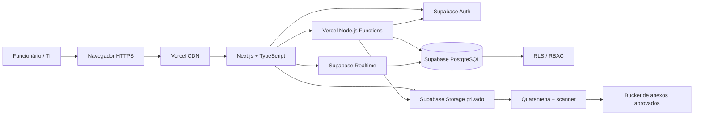
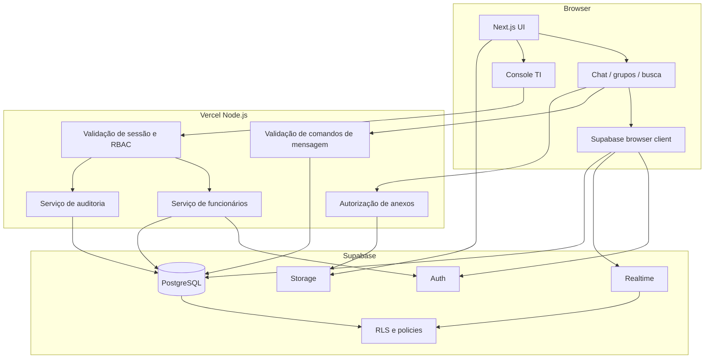
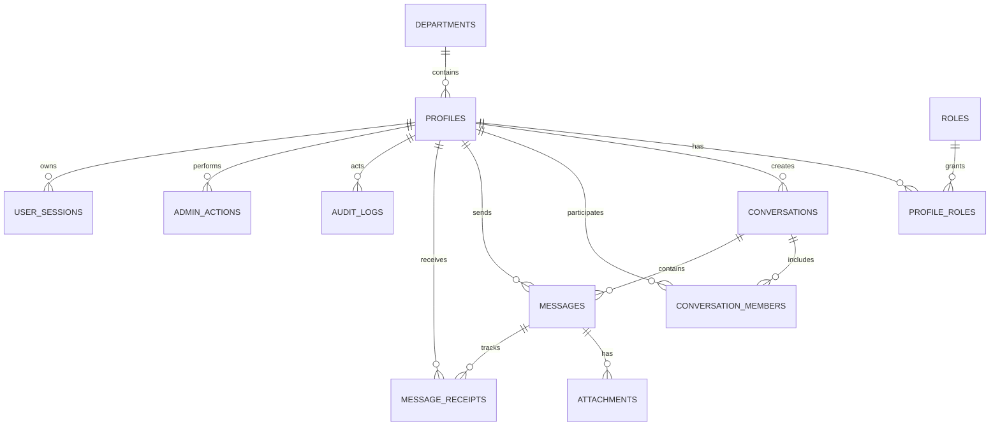
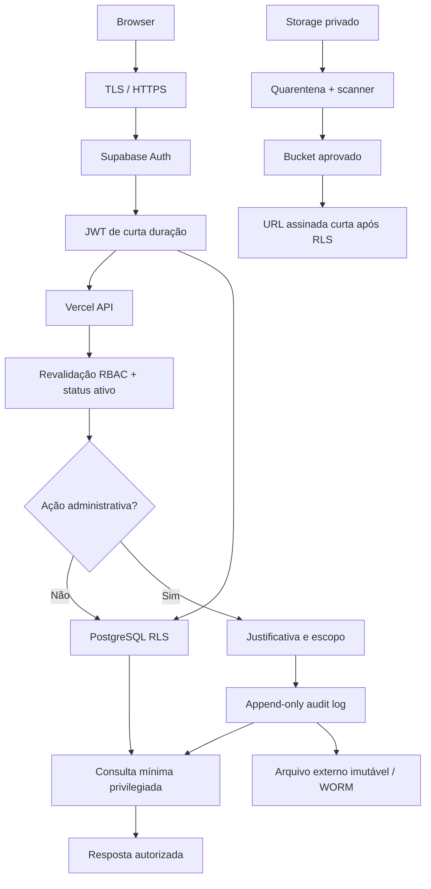
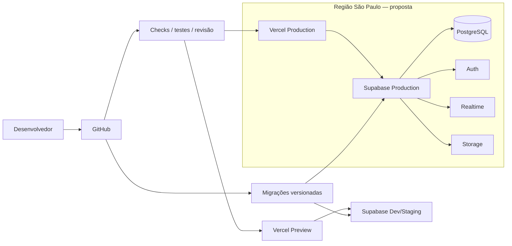
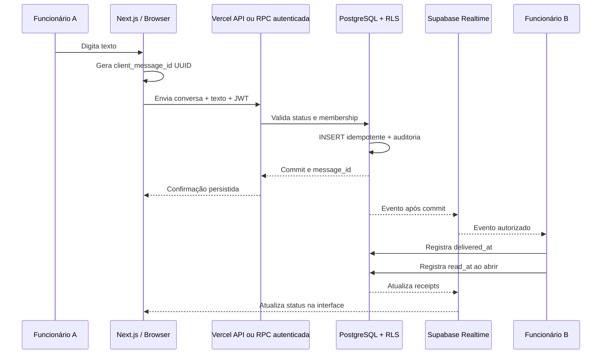

# Arquitetura técnica — Chat Corporativo Privado da Calunga

**Versão:** 1.1 — adaptação aos planos gratuitos  
**Data:** 18/11/2026  
**Status:** MVP gratuito para desenvolvimento/homologação; não aprovado para produção corporativa  
**Repositório:** `otaviosferreira/chatapp`

> Esta documentação define uma arquitetura de referência para um MVP sem custo de assinatura de Vercel Hobby e Supabase Free. Não representa certificação de segurança, conformidade LGPD, SLA ou dimensionamento definitivo. **Atenção: Vercel Hobby é destinado a uso pessoal e não comercial; por isso, esta configuração não deve hospedar o sistema corporativo real da Calunga.** Use somente dados sintéticos ou anonimizados em desenvolvimento/demonstração. Produção exige plano/provedor cujos termos autorizem uso comercial e controles adequados.

## Sumário

1. [Resumo e princípios](#1-resumo-e-princípios)
2. [Arquitetura de hardware e infraestrutura](#2-arquitetura-de-hardware-e-infraestrutura)
3. [Arquitetura de software e aplicações](#3-arquitetura-de-software-e-aplicações)
4. [Arquitetura de dados](#4-arquitetura-de-dados)
5. [Arquitetura de segurança](#5-arquitetura-de-segurança)
6. [Arquitetura de nuvem](#6-arquitetura-de-nuvem)
7. [Diagramas técnicos](#7-diagramas-técnicos)
8. [Custos e escalabilidade](#8-custos-e-escalabilidade)
9. [Riscos e limitações](#9-riscos-e-limitações)
10. [ADRs — decisões arquiteturais](#10-adrs--decisões-arquiteturais)
11. [Plano de implantação](#11-plano-de-implantação)
12. [Checklist de validação](#12-checklist-de-validação)
13. [Referências oficiais](#13-referências-oficiais)

---

## 1. Resumo e princípios

### 1.1. Arquitetura escolhida

- **Frontend:** Next.js com TypeScript, React e App Router.
- **Hospedagem e backend web:** Vercel, com Node.js Functions para rotas de servidor e operações administrativas.
- **Backend gerenciado:** Supabase.
  - Supabase Auth: identidade e sessões.
  - PostgreSQL: dados transacionais.
  - Supabase Realtime: eventos de mensagens e atualização da interface.
  - Supabase Storage: anexos privados PDF/JPEG.
  - Edge Functions: tarefas específicas próximas aos serviços Supabase, se justificadas.
  - RLS: autorização por linha no banco e políticas do Storage.
- **Código e CI/CD:** GitHub conectado à Vercel.
- **Observabilidade:** Vercel Observability e logs/monitoramento Supabase; exportação adicional de auditoria de segurança conforme necessidade de imutabilidade.

### 1.2. Princípios arquiteturais

1. Sem cadastro público, login anônimo ou usuários externos.
2. TI cria/convoca funcionários em operação autenticada no servidor.
3. A autorização é aplicada no banco/servidor, nunca somente na interface.
4. Funcionário só acessa conversas das quais é membro ativo.
5. Mensagens e evidências de auditoria são preservadas; não haverá exclusão definitiva por administradores comuns.
6. Upload direto para Storage privado, nunca passando o binário pela Function da Vercel.
7. Mensagem é persistida antes de ser considerada enviada; Realtime é transporte de evento, não o armazenamento definitivo.
8. Auditoria de conteúdo é explícita, justificada, restrita e registrada.
9. Dados e serviços primários ficam preferencialmente em São Paulo, sujeito à validação contratual e de residência de dados.
10. Nenhuma funcionalidade proibida será incluída: áudio, vídeo, chamadas, captura de fotos, Office, canais públicos, convites públicos ou comunicação externa.

### 1.3. Premissas pendentes

- Número atual e projetado de funcionários, usuários simultâneos e volume de mensagens.
- Limite máximo de tamanho de PDF/JPEG.
- Retenção de mensagens, anexos, logs e backups.
- SLA, RPO e RTO aprovados.
- Política de MFA, expiração de sessão e dispositivos.
- Quem pode auditar conteúdo e em quais circunstâncias.
- SMTP corporativo para convites/recuperação.
- Aprovação de TI/Jurídico para uso de provedores gratuitos e transferência internacional.

### 1.4. Limitação crítica dos planos gratuitos

- **Vercel Hobby (US$ 0):** a política do plano limita o uso a projetos pessoais e não comerciais. O chat da Calunga é um sistema interno empresarial; portanto, o Hobby não é uma opção válida para produção corporativa, mesmo que tecnicamente consiga publicar a aplicação.
- **Supabase Free (US$ 0):** adequado para protótipo e testes limitados. Inclui 500 MB de banco, 1 GB de Storage, 5 GB de egress, 5 GB de cached egress e 50.000 MAU; projetos podem ser pausados após uma semana de baixa atividade. Não inclui backups automáticos nem PITR.
- A combinação Free deve ser tratada como ambiente temporário de desenvolvimento/homologação com dados fictícios. Não inserir mensagens reais, dados pessoais de funcionários, documentos internos ou anexos confidenciais.
- O custo de assinatura das duas plataformas é US$ 0, mas domínio, scanner antimalware, cópias externas, e-mail, monitoramento e serviços auxiliares podem gerar custos.
- Não prometer disponibilidade, recuperação, imutabilidade de auditoria ou continuidade empresarial com esse arranjo.

## 2. Arquitetura de hardware e infraestrutura

### 2.1. Infraestrutura de hospedagem

Não serão provisionadas máquinas físicas ou VMs próprias para o caminho principal. Vercel e Supabase operam os recursos de computação gerenciada:

| Componente | Provedor | Responsabilidade |
|---|---|---|
| CDN, TLS e frontend Next.js | Vercel | Entrega web global, build e deploy |
| Rotas de API/Server Functions | Vercel | Validação, regras de aplicação e ações privilegiadas |
| PostgreSQL | Supabase | Persistência relacional e transações |
| Auth | Supabase | Usuários, login, JWT e refresh tokens |
| Realtime | Supabase | Distribuição de mudanças/eventos |
| Storage | Supabase | Objetos PDF/JPEG privados |
| Edge Functions | Supabase | Processamento complementar quando fizer sentido |
| Dispositivos e rede local | Calunga | Navegadores, endpoints, EDR, atualização e acesso corporativo |
| Identidade e governança | Calunga | Aprovação de contas, papéis, retenção e auditoria |

### 2.2. Região

**Recomendação inicial:** Supabase em South America (São Paulo), código `sa-east-1`; Vercel Functions em São Paulo, `gru1`. A proximidade reduz latência entre a aplicação e o banco. A CDN da Vercel entrega assets a partir de pontos de presença próximos ao usuário, mas funções devem executar perto da origem dos dados.

A escolha de região não prova conformidade LGPD por si só. Confirmar:
- localização efetiva de backups, logs, suporte e subprocessadores;
- termos de transferência internacional;
- contrato de tratamento de dados;
- exigências internas de residência de dados.

Se Vercel/Supabase não oferecerem região, failover ou SLA suficiente para os requisitos aprovados, documentar a lacuna antes da produção.

### 2.3. Ambientes no cenário gratuito

O limite de projetos e a ausência de isolamento/controles pagos exigem simplificação. Não usar um mesmo banco para desenvolvimento e dados reais.

| Ambiente | Vercel | Supabase | Dados |
|---|---|---|---|
| Desenvolvimento | Hobby, uso não comercial | Projeto Free 1 | Dados sintéticos |
| Demonstração/homologação limitada | Preview protegido, ainda sujeito aos termos Hobby | Projeto Free 2, se necessário | Dados sintéticos/anonimizados |
| Produção corporativa | **Não utilizar Vercel Hobby** | **Não aprovar Supabase Free como produção sem avaliação formal** | Dados reais somente após aprovação e plano compatível |

Regras:
- Não colocar dados reais da Calunga nos ambientes gratuitos.
- Não usar Preview com dados de produção.
- Segredos distintos por ambiente.
- Migrações versionadas e aplicadas manualmente/controladamente.
- Os dois projetos Free ativos do Supabase são um limite máximo da conta/organização, não uma arquitetura de alta disponibilidade.
- Para produção, reavaliar planos e criar ambientes isolados apropriados.

### 2.4. Dispositivos e navegadores

- Windows, Android e iOS por navegador moderno: Chrome, Edge, Firefox e Safari.
- Layout responsivo; HTTPS obrigatório.
- Recomendar sistema operacional e navegador atualizados, bloqueio de tela e proteção corporativa de endpoint.
- Não solicitar permissões de microfone, câmera ou gravação.
- O seletor de arquivos deve aceitar apenas PDF/JPEG e não deve acionar captura de câmera.
- A aplicação não controla cópias, screenshots ou fotografia externa do conteúdo exibido; política corporativa e controles de endpoint são complementares.

### 2.5. Disponibilidade, backup e continuidade no Free

**Não definir RPO/RTO empresarial para a configuração gratuita.** Não há backup automático do banco nem PITR no Supabase Free, e não há garantia de que o projeto permaneça ativo se ficar com baixa atividade por uma semana.

Plano mínimo para dados exclusivamente fictícios:
1. Fazer exportação lógica manual e frequente do banco com Supabase CLI (db dump), armazenando-a fora do projeto.
2. Exportar também os objetos do Storage; dump do banco não inclui os binários dos arquivos.
3. Criptografar cópias, restringir acesso e testar restauração em projeto separado.
4. Documentar que backup manual depende de execução e conferência humana.
5. Não considerar cópia no mesmo projeto como backup independente.
6. Não usar o plano Free para guardar evidências ou histórico corporativo que precise de recuperação garantida.

A produção só poderá ser aprovada depois de contratar solução com backup automatizado, retenção definida, restauração testada e RPO/RTO formalmente aceitos.

## 3. Arquitetura de software e aplicações

### 3.1. Frontend

Next.js + TypeScript:
- App Router com páginas protegidas.
- Componentes: layout, lista de conversas, thread, composer de texto, seletor de anexo restrito, participantes, busca, perfil e painel TI.
- Estado local para interface; cache/query para dados; atualização em tempo real por Supabase Realtime.
- Cliente Supabase no browser usa apenas publishable/anon key e sessão do usuário.
- SSR/server components devem obter identidade validada no servidor; não confiar em sessão armazenada apenas em estado React.
- Cookies seguros, HttpOnly quando aplicável ao fluxo SSR, Secure, SameSite e proteção CSRF nas rotas mutáveis baseadas em cookie.
- Acessibilidade por teclado, leitores de tela e layout mobile.

### 3.2. Backend Vercel

Rotas server-side agrupadas por domínio:
- `/api/admin/employees`: criar/invitar, editar, ativar/desativar funcionário.
- `/api/admin/audit`: consultar conteúdo e metadados de auditoria.
- `/api/conversations`: operações que exijam validação de negócio adicional.
- `/api/attachments/authorize`: iniciar upload e emitir autorização curta, se necessário.
- `/api/health`: saúde operacional sem expor segredos.

Regras:
- Validar JWT/sessão com Supabase Auth e obter usuário autenticado.
- Revalidar papel e status do funcionário no banco em cada operação sensível.
- Validar esquema de entrada (ex.: Zod), autorização, limites, rate limit e logs.
- Nunca confiar em role enviado pelo cliente ou em `user_metadata`.
- Chave Supabase secret/service_role somente em variável server-side sem prefixo `NEXT_PUBLIC_`.
- A chave privilegiada deve ser usada apenas por rotas específicas, com validação de autorização e trilha de auditoria; preferir chamadas com token do usuário e RLS para operações comuns.
- Não fazer proxy de upload binário através de Vercel Functions: payload máximo documentado de 4,5 MB. Upload deve ir direto ao Storage com autorização temporária.
- No Hobby, funções têm cotas de execução/CPU e duração limitada (10 s padrão; até 60 s configurável segundo a documentação do plano). Evitar processamento pesado, tarefas longas e scanner dentro de uma Function.

### 3.3. Supabase Free

| Serviço | Uso no MVP gratuito | Limite/ressalva |
|---|---|---|
| Auth | Contas pré-provisionadas e login | Até 50.000 MAU incluídos; não habilitar cadastro público |
| PostgreSQL | Dados de teste | 500 MB por projeto; CPU/RAM compartilhadas |
| RLS | Autorização por usuário/conversa | Disponível; precisa de testes negativos rigorosos |
| Realtime | Eventos do chat de demonstração | Medir conexões, mensagens e fan-out; respeitar cotas do Free |
| Storage | Anexos de teste, se liberados | 1 GB total; egress limitado |
| Edge Functions | Tarefas pequenas | Não depender de processamento demorado |
| Backups | Exportação manual | Sem backup automático e sem PITR no Free |

Manter o banco pequeno: paginação obrigatória, retenção limitada apenas para dados fictícios e limpeza de dados de teste com rotina aprovada. Não assumir que “API requests ilimitadas” significa capacidade ilimitada de banco, CPU, conexões ou tráfego.

### 3.4. Módulos e dependências

| Módulo | Responsabilidade | Dependências |
|---|---|---|
| Autenticação/sessões | Login, logout, MFA, recuperação, expiração | Supabase Auth, Vercel |
| Funcionários | Provisionar, atualizar, suspender contas | Auth Admin API server-side, profiles, audit |
| Conversas individuais | Criar/recuperar conversa privada | conversations, members, RLS |
| Grupos privados | Criar grupo e gerir participantes | conversations, members, permissões |
| Mensagens | Enviar, persistir, paginar e responder | PostgreSQL, RLS, Realtime |
| Arquivos | Upload, validação, download autorizado | Storage, attachments, scanner |
| Notificações | Não lidas e notificações web | receipts, Realtime, permissões do browser |
| Histórico/busca | Pesquisa por texto e período | PostgreSQL, índices |
| Auditoria TI | Consulta controlada de mensagens/arquivos | RBAC, API server, audit_logs |
| Permissões | RBAC e políticas por recurso | roles, profiles, RLS |
| Segurança/monitoramento | Eventos, alertas e resposta | logs Vercel/Supabase, exportação |

### 3.5. Realtime e consistência

**Fonte de verdade:** PostgreSQL. O cliente primeiro envia a mensagem por operação autenticada; o banco confirma a transação; só então a interface mostra o estado persistido. Realtime atualiza os demais clientes.

Padrão recomendado:
1. Cliente gera `client_message_id` UUID.
2. Envia conteúdo e conversa para rota/RPC autenticada.
3. Banco valida usuário ativo, associação à conversa e conteúdo.
4. Transação insere mensagem e evento/auditoria necessário.
5. Retorna ID definitivo e timestamp.
6. Realtime notifica clientes autorizados.
7. Destinatário atualiza a tela e grava receipt de entrega; ao abrir a conversa, grava receipt de leitura.

Prevenção de inconsistência:
- Restrição única em `(sender_id, conversation_id, client_message_id)` para idempotência.
- Ordenação por `created_at, id`, com paginação por cursor.
- Retries com o mesmo `client_message_id`, sem criar duplicata.
- Recarregar mensagens após reconexão usando o último cursor confirmado.
- Não assumir que evento Realtime significa persistência bem-sucedida.
- Mensagens não devem ser editadas/excluídas na primeira versão, salvo requisito posterior aprovado e com histórico imutável de alterações.

Para escala inicial, Postgres Changes pode ser suficiente com RLS. Testes de carga devem medir custo de fan-out. Para alto volume, avaliar Broadcast privado após persistência e política RLS em `realtime.messages`. Desabilitar acesso público a canais e exigir canais privados autorizados. A revogação de membro precisa considerar cache de autorização durante conexão; manter JWT curto, revalidar status e encerrar sessões/canais em suspensão.

### 3.6. Notificações

- In-app: Realtime e contador de não lidas.
- Browser Push: opcional, somente após consentimento/permissão do navegador e decisão de TI.
- Não incluir conteúdo sensível em notificações de tela bloqueada; preferir “Nova mensagem”.
- Notificações não substituem a persistência nem a consulta do histórico.
- Não implementar e-mail de comunicado corporativo; comunicados continuam via e-mail conforme escopo.

---

## 4. Arquitetura de dados

### 4.1. Modelo lógico

Todas as tabelas de aplicação devem ter RLS habilitada quando expostas. Tabelas internas de auditoria e auxiliares devem ficar em schema não exposto quando possível.

| Entidade | Campos principais | Chaves/regras |
|---|---|---|
| `departments` | id UUID, name, code, active, created_at | PK id; code único |
| `roles` | id UUID, code, name, description | PK id; code único: employee, it_admin, security_admin |
| `profiles` | id UUID, auth_user_id UUID, employee_code, full_name, corporate_email, department_id, status, created_at, updated_at, disabled_at | PK id; auth_user_id FK auth.users único; employee_code e email únicos; department_id FK |
| `profile_roles` | profile_id, role_id, granted_by, granted_at | PK composta; FKs profiles/roles; alteração só por TI autorizada |
| `conversations` | id UUID, type, title, created_by, created_at, direct_key, archived_at | PK id; type direct/group; direct_key único para conversa individual canônica |
| `conversation_members` | conversation_id, profile_id, member_role, joined_at, left_at, added_by | PK composta (conversation_id, profile_id); FKs; membro ativo quando left_at IS NULL |
| `messages` | id UUID, conversation_id, sender_id, client_message_id, body, reply_to_id, created_at | PK id; FK conversation/sender; unique sender+conversation+client_message_id; body não vazio |
| `attachments` | id UUID, message_id, conversation_id, uploader_id, bucket, object_path, original_name, mime_type, size_bytes, sha256, scan_status, created_at | PK id; FKs; scan_status pending/clean/rejected; path único |
| `message_receipts` | message_id, profile_id, delivered_at, read_at | PK composta; FK message/profile |
| `audit_logs` | id UUID, actor_profile_id, action, resource_type, resource_id, reason, occurred_at, request_id, metadata, previous_hash, record_hash | PK id; append-only; acesso restrito |
| `admin_actions` | id UUID, actor_profile_id, action_type, target_profile_id, outcome, reason, occurred_at, request_id, metadata | PK id; trilha de provisionamento, suspensão, papéis e mudanças |
| `user_sessions` (opcional) | session_id UUID, profile_id, created_at, last_seen_at, revoked_at, device_label, ip_hash | PK session_id; FK profile; não armazenar access/refresh tokens |

**Observações de modelagem**
- `profiles.id` pode ser o mesmo UUID do usuário Auth para simplificar políticas; se separado, mapear explicitamente `auth_user_id`.
- `user_sessions` é apenas uma projeção operacional mínima. A fonte de verdade de sessões permanece Supabase Auth (`auth.sessions`); nunca copiar tokens.
- `admin_actions` descreve alterações administrativas; `audit_logs` registra também leitura/consulta privilegiada e eventos relevantes.
- `direct_key` deve ser derivada no servidor de dois IDs ordenados e validada por restrição única para impedir duas conversas individuais paralelas.
- Mensagens e recibos não devem ser apagados quando funcionário é desligado.
- Evitar armazenar arquivos binários no PostgreSQL.

### 4.2. Índices e integridade

Índices iniciais:
- `profiles(employee_code)` UNIQUE; `profiles(corporate_email)` UNIQUE.
- `conversation_members(profile_id, left_at, conversation_id)`.
- `messages(conversation_id, created_at DESC, id DESC)`.
- `messages(sender_id, conversation_id, client_message_id)` UNIQUE.
- `messages(reply_to_id)`.
- `attachments(message_id)`, `attachments(conversation_id, created_at DESC)`.
- `message_receipts(profile_id, read_at)`.
- `audit_logs(occurred_at DESC)`, `audit_logs(actor_profile_id, occurred_at DESC)`, `audit_logs(resource_type, resource_id)`.
- Busca de texto: avaliar índice GIN com tsvector e configuração linguística pt-BR; proteger resultados com RLS e limitar campos pesquisáveis.

Restrições:
- FK com `ON DELETE RESTRICT` para dados históricos.
- Sem endpoint de delete definitivo de profile, conversation, message ou audit.
- Status do funcionário: active, disabled, pending_invitation.
- Mensagens de texto com tamanho máximo validado no servidor.
- Somente membros ativos enviam e consultam mensagens.
- Transações para inserir mensagem + registro de auditoria/outbox quando exigido.

### 4.3. Fluxo da mensagem

1. Funcionário autentica via Supabase Auth.
2. Sessão e status ativo são validados.
3. Abre conversa; RLS confirma participação.
4. Cliente gera UUID idempotente e envia texto.
5. Backend/RPC valida conteúdo, status e membership.
6. PostgreSQL grava mensagem e registros necessários em transação.
7. Realtime emite evento após commit.
8. Clientes participantes atualizam a conversa.
9. Destinatário registra entrega e leitura.
10. Logs de segurança/auditoria preservam ações relevantes.

### 4.4. Storage e arquivos no cenário gratuito

Buckets privados:
- chat-quarantine: upload recém-recebido, sem download por usuários.
- chat-attachments: somente arquivos aprovados.

Restrições do Supabase Free:
- Cota total de Storage: **1 GB**.
- Tamanho máximo suportado pelo serviço Free: **50 MB por arquivo**; para o MVP, definir limite de aplicação bem menor, por exemplo **5 MB**, para controlar consumo e egress.
- Egress incluído: **5 GB**, além de 5 GB de cached egress.

Política:
- Extensões permitidas: .pdf, .jpg, .jpeg.
- MIME aceito: application/pdf, image/jpeg.
- Validar assinatura real do arquivo (PDF e JPEG), não confiar no nome/extensão enviados pelo navegador.
- Gerar nome interno aleatório e guardar nome original apenas como metadado tratado.
- Buckets privados, URLs assinadas de curta duração e políticas Storage/RLS.
- **Não habilitar anexos com dados reais no MVP gratuito.** A quarentena só é eficaz se houver scanner antimalware confiável. Como o plano Free não fornece scanner, escolher e validar um serviço externo antes de liberar anexos; esse serviço pode não ser gratuito.
- Se não houver scanner aprovado, manter upload desabilitado. Nunca marcar arquivo como “limpo” apenas por passar na validação de MIME/magic bytes.

## 5. Arquitetura de segurança

### 5.1. Autenticação e ciclo de vida

- Desabilitar signups públicos e anonymous sign-ins.
- Provisionar usuários exclusivamente por rota server-side autenticada de TI, usando Auth Admin API.
- Validar domínio/e-mail corporativo e matrícula antes do convite.
- Senha inicial/convite enviado por canal seguro; exigir troca no primeiro acesso, conforme fluxo escolhido.
- MFA obrigatório para administradores; recomendado para todos os funcionários.
- Recuperação de senha com e-mail corporativo verificado e política de expiração.
- Rate limit por IP e identidade; alertar tentativas anormais.
- Access token curto (ex.: 5–15 min, validar UX/risco); refresh tokens rotacionados.
- Limitar sessões concorrentes/idade máxima conforme plano e política Supabase disponível.
- No desligamento: status profile=disabled, bloquear novas operações via RLS, revogar sessões/refresh tokens no Auth Admin API, desconectar Realtime e registrar ação.
- JWT já emitido pode permanecer válido até expirar; não confiar apenas em banimento. RLS/rotas sensíveis devem consultar status atual. Realtime pode manter autorização em cache até expiração/atualização do JWT; usar TTL curto e revogação explícita de canais.

### 5.2. RBAC e RLS

Papéis:
- **employee:** conversar com membros autorizados, participar de grupos, enviar texto e PDF/JPEG.
- **it_admin:** provisionar/editar/desabilitar contas e administrar grupos conforme política; auditoria de conteúdo somente por fluxo justificado e registrado.
- **security_admin:** consultar logs de segurança e trilhas de auditoria; conteúdo de mensagens somente quando houver permissão específica e justificativa aprovada.

Regras RLS obrigatórias:
- `profiles`: funcionário lê diretório mínimo necessário; usuário altera apenas campos não privilegiados do próprio perfil; não altera status, departamento sensível ou papel.
- `conversations`: SELECT se existe membership ativo; INSERT apenas via operação validada; UPDATE apenas criador/admin de grupo conforme permissão.
- `conversation_members`: SELECT para membros da conversa; INSERT/UPDATE apenas criador/administrador autorizado; nunca permitir que usuário se adicione a conversa arbitrária.
- `messages`: SELECT apenas para membros ativos; INSERT apenas se sender_id=auth.uid/profile mapeado, ativo e membro ativo; UPDATE/DELETE negados no modelo inicial.
- `attachments`: SELECT somente por membership e scan_status=clean; INSERT apenas no bucket quarantine e com metadados validados.
- `message_receipts`: usuário cria/atualiza somente o próprio receipt.
- `audit_logs` e `admin_actions`: sem SELECT/UPDATE/DELETE para funcionário comum; leitura por APIs administrativas restritas.
- Todas as tabelas expostas com RLS habilitada; grants e políticas explícitas.

Não usar `user_metadata` para autorização. Papéis devem vir de tabelas protegidas e/ou app_metadata gerenciada por servidor, com revalidação. Cuidado com views (usar `security_invoker = true` quando aplicável) e funções SECURITY DEFINER. Se uma função SECURITY DEFINER for inevitável, schema não exposto, search_path fixo, checagem explícita de auth.uid, grants EXECUTE mínimos e revisão de segurança.

### 5.3. Auditoria administrativa de conteúdo

Acesso de auditoria não deve ser uma policy ampla que torne todas as mensagens diretamente legíveis por qualquer administrador:
1. Administrador entra em rota protegida da Vercel.
2. Servidor valida identidade, status, papel e escopo.
3. Exige justificativa quando política determinar.
4. Registra tentativa/consulta em `audit_logs` antes ou na mesma transação lógica da consulta.
5. Busca somente o recurso autorizado.
6. Registra resultado, IDs consultados, request_id e horário.
7. Retorna conteúdo mínimo necessário.

A chave service_role/secret key pode ignorar RLS; por isso, somente rotas mínimas no servidor podem usá-la. Nunca aceitar `role`, `actor_id` ou `reason` como prova de autorização fornecida pelo browser.

Imutabilidade:
- Bloquear UPDATE/DELETE por roles de aplicação.
- Triggers e privilégios separados para append-only.
- Hash encadeado ou assinatura periódica para detecção de adulteração.
- Exportação contínua para repositório de logs independente e append-only/WORM, com credenciais separadas, se o requisito for resistência também a um proprietário do projeto Supabase.
- A proteção dentro do mesmo projeto não impede que um owner com privilégios de plataforma altere tudo; imutabilidade forte requer segregação administrativa e armazenamento independente.

### 5.4. Criptografia

- TLS/HTTPS para browser, Vercel e Supabase.
- Criptografia em repouso fornecida pela plataforma de hospedagem/banco/storage, conforme contrato/plano.
- Segredos em variáveis de ambiente protegidas e gerenciador de segredos.
- Rotação programada e após incidente.
- Hash de senha gerenciado pelo Supabase Auth; nunca armazenar senha em profiles.
- Criptografia de backup/exportações com chaves controladas pela Calunga quando possível.
- Modelo de acesso a mensagens: serviço e administradores autorizados podem acessar plaintext, para permitir auditoria; não chamar isso de E2EE.
- Avaliar criptografia em nível de aplicação para campos particularmente sensíveis, desde que a arquitetura de auditoria tenha mecanismo formal de acesso às chaves e trilha de uso.

### 5.5. Ameaças e mitigação

| Ameaça | Controle |
|---|---|
| SQL Injection | SQL parametrizado, query builder, validação de entrada |
| XSS | React escaping, sanitização de conteúdo renderizado, CSP, não renderizar HTML arbitrário |
| CSRF | SameSite, token anti-CSRF para cookies, checagem Origin nas rotas mutáveis |
| Força bruta | Rate limit, MFA, alertas, bloqueio progressivo |
| Roubo de sessão | HTTPS, cookies seguros, token curto, revogação e proteção contra XSS |
| Escalada de privilégio | RBAC server-side, RLS, papel fora de user_metadata |
| IDOR/BOLA | Membership check por cada conversa, mensagem e arquivo |
| Upload malicioso | Quarentena, magic bytes, parser, antimalware, URL assinada curta |
| Vazamento de segredos | Sem service_role no client bundle; secret scanning; rotação |
| Acesso indevido ao banco | RLS, least privilege, network/security settings, MFA no painel |
| Abuso administrativo | Justificativa, audit trail, segregação de funções, alertas |
| Exfiltração | Limites, paginação, monitoramento de consultas em massa e exportações controladas |

### 5.6. Segurança operacional

- MFA para contas administrativas e para os painéis dos provedores, quando disponível.
- Membros de equipe com privilégio mínimo.
- Proteção da branch principal, revisão de código e CI.
- Dependências pinadas e lockfile versionado; análise de vulnerabilidades.
- Secret scanning e rotação imediata de segredo comprometido.
- CSP, HSTS, frame-ancestors, X-Content-Type-Options e Referrer-Policy.
- Logs sem tokens, senhas ou conteúdo completo de mensagem por padrão.
- Runbook de incidente com classificação, contenção, preservação de evidências, comunicação e lições aprendidas.
- Testes SAST/DAST, revisão de RLS e testes de autorização antes de qualquer piloto.

**Limitações específicas do Free:** logs e observabilidade têm retenção/recursos reduzidos; não há log drain e nem arquivo WORM fornecido pelo plano. Um audit_logs append-only dentro do mesmo projeto não é imutável contra o proprietário do projeto. Para produção, exportar auditoria para destino independente e imutável, com segregação de administração.

## 6. Arquitetura de nuvem

### 6.1. Vercel Hobby

- Uso restrito a projetos pessoais e não comerciais segundo os termos do plano Hobby.
- **Não usar para hospedar a operação corporativa da Calunga.** Utilizar apenas protótipo/demonstração com dados fictícios.
- O Hobby oferece deploy via Git e Preview, mas sem recursos de colaboração de equipe do Pro.
- Limites publicados incluem 1 milhão de invocações de Functions, 4 CPU-horas ativas, 360 GB-horas de memória provisionada e 6.000 minutos de build por ciclo/mês, além de limites de duração e logs reduzidos; consultar a página de limites vigente.
- Functions: evitar tarefas longas; duração padrão de 10 s e máximo configurável de até 60 s no Hobby.
- Não pressupor log retention, suporte, SLA, proteção avançada ou observabilidade empresarial.
- Variáveis de ambiente por ambiente; segredos nunca no browser.
- Antes de qualquer uso comercial, migrar para plano cujos termos autorizem esse uso e validar recursos de segurança/colaboração.

### 6.2. Supabase Free

- Até dois projetos Free ativos por organização/conta conforme a regra vigente.
- Banco de 500 MB por projeto, Storage de 1 GB, egress de 5 GB e cached egress de 5 GB.
- Até 50.000 usuários ativos mensais incluídos.
- Projeto pode ser pausado após uma semana de baixa atividade.
- Sem backup automático, sem PITR e sem garantia de continuidade empresarial.
- Auth sem cadastro público; criar usuários somente por operação administrativa segura.
- Realtime com canais privados e autorização RLS; medir consumo e limitar fan-out.
- Storage privado; anexos de usuários reais desabilitados até haver scanner e backup de objetos.
- RLS em todas as tabelas expostas; não confiar em user_metadata para autorização.
- Fazer exportações manuais e testar restauração; nunca chamar isso de backup automatizado.

### 6.3. Integração

Fluxo normal:
1. Browser carrega Next.js pela Vercel.
2. Usuário autentica no Supabase Auth.
3. Browser usa publishable key + JWT do usuário para operações permitidas e protegidas por RLS.
4. Operações administrativas passam por Vercel Functions.
5. Function valida JWT, consulta papel/status e executa operação privilegiada estritamente necessária.
6. PostgreSQL persiste dados.
7. Realtime distribui eventos autorizados.
8. Storage entrega arquivo privado por URL assinada curta.

Não usar a chave secret/service_role em variáveis `NEXT_PUBLIC_*`, código client, logs, source maps ou repositório.

---

## 7. Diagramas técnicos

### Diagrama 1 — Arquitetura geral

### Diagrama 2 — Arquitetura de software

### Diagrama 3 — Modelo de dados

### Diagrama 4 — Segurança e auditoria

### Diagrama 5 — Nuvem e implantação

### Diagrama 6 — Envio de mensagem

---

## 8. Custos e escalabilidade

### 8.1. Premissas de dimensionamento

Não foram fornecidos quantitativos de funcionários, mensagens/dia, tamanho médio de anexo, usuários simultâneos ou retenção. Portanto, não é tecnicamente correto estimar um custo mensal total fechado.

Coletar:
- (U): usuários ativos mensais;
- (C): conexões simultâneas de pico;
- (M): mensagens persistidas por dia;
- (F): anexos por dia;
- (S): tamanho médio do anexo;
- (D): dias de retenção;
- (R): fator médio de destinatários por mensagem.

Estimativas:
- Armazenamento de arquivos ≈ (F \times S \times D), descontadas exclusões por política (não aplicável a históricos preservados).
- Realtime depende de fan-out: mudanças Postgres contam por cliente inscrito; Broadcast conta mensagem enviada + cada destinatário.
- Banco cresce com mensagens, receipts, índices, audit logs e metadados.
- Egress cresce com leitura de histórico, anexos e conexões.
- Dimensionar conexões com pooler e evitar abrir conexão PostgreSQL por usuário.

### 8.2. Referência de preços consultada em 18/11/2026 — planos gratuitos

| Plataforma | Plano | Custo de assinatura | Limites relevantes |
|---|---|---:|---|
| Vercel | Hobby | US$ 0/mês | Uso pessoal/não comercial; cotas de Functions/build/logs; não adequado à produção empresarial |
| Supabase | Free | US$ 0/mês | 500 MB banco, 1 GB Storage, 5 GB egress, 5 GB cached egress, 50.000 MAU; pausa por inatividade |
| **Total de assinatura** |  | **US$ 0/mês** | Não inclui serviços externos ou custos indiretos |

Custos que podem continuar existindo: domínio, e-mail/SMTP, scanner antimalware, backup externo, monitoramento, suporte e mão de obra operacional. Portanto, “US$ 0” significa somente que as assinaturas-base desses dois planos são gratuitas.

Fontes oficiais:
- Vercel Hobby: https://vercel.com/docs/plans/hobby
- Vercel preços: https://vercel.com/pricing
- Supabase preços: https://supabase.com/pricing
- Supabase pausa por inatividade: https://supabase.com/docs/guides/platform/free-project-pausing
- Supabase backups: https://supabase.com/docs/guides/platform/backups

### 8.3. Escalabilidade no Free

- Tratar como protótipo com poucos usuários e dados sintéticos.
- Monitorar banco (500 MB), Storage (1 GB), egress (5 GB), cached egress (5 GB), usuários ativos e cotas de Functions.
- Paginar histórico, limitar anexos e não carregar conversas inteiras.
- Testar fan-out com grupos pequenos.
- Não assumir escalabilidade horizontal, alta disponibilidade ou capacidade de pico.
- Planejar migração para plano comercial antes de qualquer uso corporativo real.
- Monitorar conexões, CPU, memória, IOPS, tamanho do banco, egress, Storage, Realtime messages e peak connections.
- Paginar histórico e índices adequados.
- Não carregar todo o histórico em cada abertura de conversa.
- Aplicar limites de mensagens, anexos e pesquisa.
- Separar tarefas pesadas de request/response.
- Testar fan-out de grupos grandes.
- Considerar particionamento de mensagens/audit logs apenas quando volume justificar.
- Avaliar read replicas e estratégias de arquivamento somente após métricas e requisitos de retenção.

---

## 9. Riscos e limitações

| Risco/lacuna | Impacto | Mitigação/decisão pendente |
|---|---|---|
| Auditoria de conteúdo amplia risco de abuso interno | Alto | Justificativa, RBAC, trilha imutável, revisão periódica |
| Logs no mesmo projeto podem ser alterados por owner | Alto | Arquivo independente/WORM e segregação de administração |
| Revogação de JWT não é instantânea em todos os clientes conectados | Alto | TTL curto, consulta de status no servidor/RLS, revogar sessões e encerrar canais |
| RLS incompleta ou mal testada | Crítico | Matriz de autorização, testes negativos por tabela e revisão externa |
| Upload malicioso | Alto | Quarentena, scanner, parser e URLs assinadas |
| Supabase/Vercel como dependência de fornecedor | Médio/alto | Exportação, IaC/migrações, plano de continuidade e avaliação contratual |
| Backup de banco não equivale a backup de Storage | Alto | Plano independente para objetos e teste de restauração |
| Supabase Free não possui backup automático/PITR e pode pausar projeto | Crítico | Somente dados fictícios; exportação manual e migração para plano com backup antes de produção |
| Vercel Hobby restringe uso a pessoal/não comercial | Crítico | Não hospedar sistema corporativo; migrar para plano com termos comerciais antes do go-live |
| Cotas Free de banco, Storage e egress podem ser esgotadas | Alto | Monitorar cotas; limitar histórico/anexos e não armazenar dados reais |
| Ausência de scanner e WORM incluídos no Free | Alto | Desabilitar anexos reais e exportar auditoria para serviço independente na produção |
| Realtime pode gerar alto fan-out/custo | Médio | Teste de carga e otimização de canais/subscrições |
| Ausência de quantitativos | Médio | Descoberta de carga antes de fechar plano |
| Região e transferência internacional | Alto | DPA, sub-processadores, revisão jurídica e configuração de região |
| E-mail corporativo/SMTP ainda não definido | Médio | Definir provedor e validar SPF/DKIM/DMARC |
| Push web varia por browser/dispositivo | Baixo/médio | Manter notificações in-app como mecanismo principal |

---

## 10. ADRs — decisões arquiteturais

### ADR-001 — Next.js + Vercel para camada web

- **Problema:** hospedar interface web responsiva e endpoints server-side.
- **Alternativas:** servidor próprio, outro provedor cloud.
- **Escolha:** Next.js/TypeScript na Vercel.
- **Justificativa:** deploy Git, Preview, CDN e Functions integradas.
- **Consequências:** dependência de plataforma e limites de Functions; upload binário não passa por Functions. Hobby é não comercial e, portanto, serve apenas ao protótipo, não à operação da Calunga.

### ADR-002 — Supabase como backend principal

- **Problema:** banco, Auth, Storage e Realtime integrados.
- **Alternativas:** serviços autogerenciados ou outros BaaS.
- **Escolha:** Supabase.
- **Justificativa:** Postgres, RLS, Auth, Realtime e Storage no mesmo ecossistema.
- **Consequências:** políticas RLS exigem engenharia e testes rigorosos; Free limita banco/Storage/egress, pausa por inatividade e não oferece backup automático/PITR; não usar como produção corporativa.

### ADR-003 — Região São Paulo

- **Problema:** latência e residência dos dados para usuários no Brasil.
- **Alternativas:** regiões dos EUA/Europa.
- **Escolha:** Supabase `sa-east-1` e Vercel `gru1`, após validação.
- **Justificativa:** proximidade entre usuários, funções e banco.
- **Consequências:** confirmar disponibilidade, preço, redundância, backup e requisitos legais.

### ADR-004 — Sem E2EE entre usuários

- **Problema:** permitir auditoria administrativa de mensagens.
- **Alternativas:** E2EE estrita; criptografia em trânsito/em repouso com acesso empresarial controlado.
- **Escolha:** criptografia de transporte e repouso com acesso administrativo excepcional.
- **Justificativa:** compatibilidade com auditoria prevista pelo cliente.
- **Consequências:** risco de abuso interno; exige transparência, segregação e logs de consulta.

### ADR-005 — Storage privado com quarentena

- **Problema:** permitir apenas PDF/JPEG seguros.
- **Alternativas:** bucket público; upload direto sem scanner.
- **Escolha:** bucket privado de quarentena, inspeção e promoção a bucket aprovado.
- **Justificativa:** validação de conteúdo e autorização antes do download.
- **Consequências:** scanner complementar e fluxo assíncrono são necessários.

### ADR-006 — PostgreSQL como fonte de verdade

- **Problema:** garantir consistência e histórico.
- **Alternativas:** mensagens somente em memória ou eventos Realtime como persistência.
- **Escolha:** persistir em Postgres e usar Realtime como notificação.
- **Justificativa:** transações, constraints, histórico e recuperação.
- **Consequências:** dimensionar banco e fan-out; implementar idempotência e reconexão.

### ADR-007 — Auditoria administrativa por API controlada

- **Problema:** TI precisa consultar mensagens sem conceder leitura irrestrita a todos os administradores.
- **Alternativas:** policy RLS que permite todos os admins lerem tudo; API com autorização e justificativa.
- **Escolha:** API server-side restrita com registro append-only.
- **Justificativa:** menor privilégio e accountability.
- **Consequências:** rotas privilegiadas precisam de revisão, testes e proteção de segredos.

### ADR-008 — Contas desabilitadas, nunca apagadas

- **Problema:** preservar histórico após desligamento.
- **Alternativas:** exclusão de Auth/profile; desativação lógica.
- **Escolha:** desativação lógica e revogação de sessões.
- **Justificativa:** requisito explícito do cliente.
- **Consequências:** retenção e processo de correção/eliminação de dados devem ser avaliados pelo Jurídico à luz da LGPD.

---

## 11. Plano de implantação

1. **Descoberta e governança:** aprovar escopo de protótipo, usuários de teste e dados fictícios.
2. **Fundação Free:** criar conta Vercel Hobby para uso pessoal/não comercial e até dois projetos Supabase Free para desenvolvimento/demonstração.
3. **Banco e identidade:** migrations, Auth sem signup público, RBAC, RLS e testes.
4. **Chat básico:** conversas individuais/grupos, mensagens idempotentes, histórico e Realtime, somente com contas de teste.
5. **Arquivos:** manter upload desabilitado até selecionar e validar scanner, política de armazenamento e backup de objetos.
6. **Administração:** provisionamento e suspensão de usuários de teste.
7. **Auditoria:** validar logs funcionais; não alegar imutabilidade enquanto permanecerem no mesmo projeto.
8. **Qualidade:** testes unitários, integrados, E2E e testes negativos de RLS.
9. **Homologação:** demonstração com dados sintéticos e sem informações internas.
10. **Bloqueio de produção:** antes do go-live, migrar para planos/provedores que permitam uso comercial e aprovar backup automático, SLA, auditoria externa, scanner, LGPD e segurança.
11. **Operação:** só após aprovação formal e plano compatível.

### Critérios mínimos para demonstração gratuita

- Signup público e anônimo desativados.
- Apenas contas de teste pré-criadas.
- Nenhum dado pessoal ou documento real da Calunga.
- Conversas e grupos protegidos por RLS e testes negativos.
- Usuário desativado perde acesso.
- Upload desabilitado até scanner e fluxo de backup serem aprovados.
- Chaves privilegiadas ausentes do bundle do navegador.
- Exportação manual e restauração demonstradas com dados sintéticos.
- Aviso claro de que o ambiente pode ser pausado e não possui SLA/RPO/RTO empresarial.

### Critérios adicionais obrigatórios antes da produção

- Plano de hospedagem autorizado para uso comercial.
- Banco e ambientes segregados.
- Backup automatizado do banco e Storage, retenção e restore testados.
- RPO/RTO e disponibilidade aprovados.
- Scanner antimalware operacional.
- Auditoria exportada para destino independente e imutável.
- Pentest, testes de carga e revisão de RLS aprovados.
- Contratos/DPA e avaliação LGPD aprovados.

## 12. Checklist de validação

### Funcional e acesso
- [ ] Sem cadastro público, signup anônimo ou acesso externo.
- [ ] Só TI provisiona funcionários.
- [ ] Funcionário desabilitado perde acesso e mantém histórico.
- [ ] Conversas individuais e grupos são privados.
- [ ] Mensagens persistem antes de confirmação de envio.
- [ ] Reconexão não duplica mensagens.
- [ ] Pesquisa respeita membership e RLS.

### Arquivos
- [ ] Apenas PDF/JPEG.
- [ ] MIME, extensão e magic bytes validados no servidor.
- [ ] Tamanho máximo configurável.
- [ ] Quarentena e antimalware implementados.
- [ ] Buckets privados e URLs curtas.
- [ ] Nenhum upload de áudio, vídeo, Office ou formatos não permitidos.

### Segurança e auditoria
- [ ] RLS em todas as tabelas expostas.
- [ ] Policies negativas testadas para BOLA/IDOR.
- [ ] Papéis não vêm de user_metadata.
- [ ] service_role/secret não chega ao browser.
- [ ] MFA de administradores habilitado.
- [ ] Sessões e revogação testadas.
- [ ] Consulta administrativa exige permissão e registra auditoria.
- [ ] Logs append-only e cópia independente testados.
- [ ] XSS, CSRF, SQLi, brute force e upload malicioso testados.

### Operação
- [ ] Ambientes dev/staging/prod separados.
- [ ] Região Supabase/Vercel confirmada.
- [ ] Backup de banco e Storage configurados.
- [ ] Restauração testada.
- [ ] RPO/RTO medidos e aprovados.
- [ ] Monitoramento e alertas ativos.
- [ ] Custos e limites acompanhados.
- [ ] Contratos/DPA e avaliação LGPD aprovados.

---

## 13. Referências oficiais

Documentação e preços consultados em 18/11/2026; revisar antes de contratar ou implementar, pois limites e preços mudam.

- [Vercel Pricing](https://vercel.com/pricing)
- [Vercel Hobby Plan e limites](https://vercel.com/docs/plans/hobby)
- [Vercel Fair Use / planos](https://vercel.com/docs/plans)
- [Vercel Environments](https://vercel.com/docs/deployments/environments)
- [Vercel Function Regions](https://vercel.com/docs/functions/configuring-functions/region)
- [Vercel Function Limitations](https://vercel.com/docs/functions/limitations)
- [Supabase Pricing](https://supabase.com/pricing)
- [Supabase Available Regions](https://supabase.com/docs/guides/platform/regions)
- [Supabase Database Backups](https://supabase.com/docs/guides/platform/backups)
- [Supabase Free Project Pausing](https://supabase.com/docs/guides/platform/free-project-pausing)
- [Supabase Free Plan Backups FAQ](https://supabase.com/kb/faqs/platform/free-plan-backups)
- [Supabase Realtime Pricing](https://supabase.com/docs/guides/realtime/pricing)
- [Supabase Realtime Authorization](https://supabase.com/docs/guides/realtime/authorization)
- [Supabase Row Level Security](https://supabase.com/docs/guides/database/postgres/row-level-security)
- [Supabase Auth Users](https://supabase.com/docs/guides/auth/users)
- [Supabase Auth Sessions](https://supabase.com/docs/guides/auth/sessions)
- [LGPD — Lei nº 13.709/2018](https://www.planalto.gov.br/ccivil_03/_ato2015-2018/2018/lei/l13709.htm)
