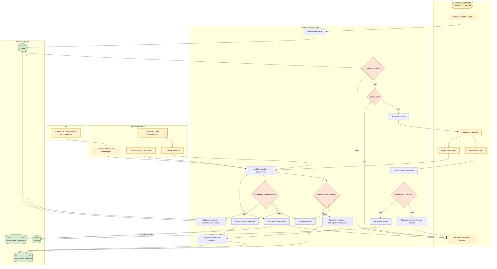

# DIAGRAMA VGI A3 — KALUM_app

**Tipo:** Diagrama de Visão Geral da Interação (UML)  
**Fonte:** reconstrução documental a partir do diagrama apresentado pela equipe no Miro, identificado como **DIAGRAMA VGI A3**.

O diagrama abaixo consolida os principais participantes, decisões e fluxos do KALUM_app. Foi organizado em Mermaid para permanecer versionável e legível no GitHub.

## Visão geral dos fluxos

## Regras de negócio representadas

- O cadastro de funcionários é restrito ao Administrador de TI; não existe auto cadastro público.
- O acesso depende de credenciais válidas e conta ativa.
- Somente usuários autenticados e autorizados podem executar operações.
- O envio de anexos aceita somente PDF e JPEG; outros formatos são bloqueados.
- O RH comunica desligamentos ao TI, que desativa a conta.
- Contas são desativadas ou reativadas, nunca excluídas; o histórico de mensagens é preservado.
- A consulta de auditoria exige permissão e também deve gerar registro de auditoria.

## Observações para validação

1. Confirmar com o Product Owner se os fluxos e atores correspondem à versão aprovada dos requisitos.
2. Definir com a equipe técnica quais mensagens e metadados podem ser consultados na auditoria, respeitando privacidade e legislação aplicável.
3. Confirmar a política de entrega de credenciais iniciais e o mecanismo de recuperação de senha.
4. Atualizar este documento quando o fluxo do Miro ou os requisitos forem alterados.

> **Atenção:** o README atual ainda descreve comunicação entre funcionários e clientes. Isso diverge dos requisitos internos discutidos pela equipe (comunicação apenas entre funcionários) e precisa ser alinhado pelo PO antes de considerar a documentação funcional definitiva.
